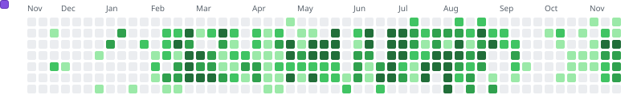

  

  
  
  

Flutter and React developer from Bhopal, India. I've worked in product companies and
startups, taking products from zero to shipped and then keeping them running.

## Stack

**Mobile** &nbsp;

**Web** &nbsp;

**Delivery** &nbsp;

## Selected work

<table>
  <tr>
    <td width="50%" valign="top">
      <h3><a href="https://hookviz.ashishtaduce.co.in/">HookViz</a></h3>
      Step-by-step visualizer for React hooks. Records real <code>useState</code> /
      <code>useEffect</code> / <code>useReducer</code> execution under the V8 debugger and
      replays it line by line.
        
      React · V8 inspector · <a href="https://hookviz.ashishtaduce.co.in/">live demo</a>
    </td>
    <td width="50%" valign="top">
      <h3><a href="https://ashishtaduce.co.in/">Adaptive Portfolio</a></h3>
      Next.js 15 portfolio with an adaptive two-column layout, animated wave divider,
      per-section layouts and 5-language i18n.
        
      TypeScript · Next.js · <a href="https://ashishtaduce.co.in/">live site</a>
    </td>
  </tr>
</table>

Most of my employer and client work is under NDA, so it lives off GitHub.

## Contributions

<picture>
  <source media="(prefers-color-scheme: dark)" srcset="https://raw.githubusercontent.com/AshishTaduce/AshishTaduce/output/snake-dark.svg">
  <source media="(prefers-color-scheme: light)" srcset="https://raw.githubusercontent.com/AshishTaduce/AshishTaduce/output/snake-light.svg">
  
</picture>
